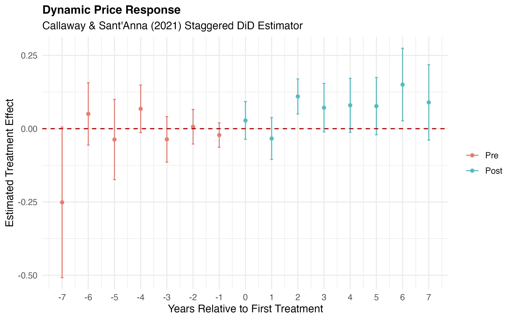

# Empirical Replication: Ethanol Plant Entry and Local Corn Prices

**Original Paper:** Jung, J., Sesmero, J., & Siebert, R. (2026). *American Journal of Agricultural Economics* (DOI: `10.1002/ajae.70099`).  
**Replication Author:** Kexi Huang  
**Date:** October 13, 2026  
**Software Environment:** R (`fixest`, `did`, `dplyr`, `tidyr`, `readxl`, `ggplot2`)

---

## 1. Project Overview & Motivation
This repository contains an end-to-end empirical replication and cross-software econometric audit of **Jung, Sesmero, and Siebert (2026)**, translating the authors' original Stata workflow (`xtreg`, `csdid`, `acreg`) into a reproducible R pipeline. 

When an industrial ethanol biorefinery enters a regional agricultural market, it introduces a localized demand shock for corn. Because grain transportation is costly, price effects are spatially heterogeneous: bid prices rise sharpest at grain elevators adjacent to the plant and decay non-linearly over distance. This project replicates the paper's core Two-Way Fixed Effects (TWFE) Difference-in-Differences specifications, dynamic staggered event-study models, spatial HAC inference checks, and Nearest-Neighbor / Propensity Score Matching (NNM/PSM) robustness analyses.

---

## 2. Econometric Identification Strategy

### 2.1 Spatial Two-Way Fixed Effects (TWFE) Difference-in-Differences
To isolate the local price premium and spatial attenuation gradient of ethanol plant entry, the core specification (Model 11, Table 3) estimates a fully saturated TWFE model across $G = 268$ grain elevators observed across pre-treatment (2004–2006) and post-treatment (2013–2014) periods ($N = 536$):

$$\text{CornPrice}_{eit} = \alpha_0 + \gamma_e + \theta_t + \delta_0 (\text{Entry}_{eit} \times \text{Post}_t) + \delta_1 (\text{Entry}_{eit} \times \text{Post}_t \times \widetilde{\text{Ratio}}_{eit}) + \delta_2 (\text{Entry}_{eit} \times \text{Post}_t \times \text{Dist}_{ei}) + \dots + \eta \text{Livestock}_{it} + \varepsilon_{eit}$$

where:
- $\text{CornPrice}_{eit}$: Real corn bid price (in 2014 USD/bushel) at grain elevator $e$ in county $i$ at period $t$.
- $\gamma_e, \theta_t$: Elevator and time fixed effects absorbing time-invariant spatial advantages and macro price shocks.
- $\widetilde{\text{Ratio}}_{eit}$: De-meaned ratio of nearby ethanol plant capacity to local county corn supply (`DMRATIONEARTOT`), centered at the pre-treatment benchmark mean.
- $\text{Dist}_{ei}$: Geographic distance (in miles) from grain elevator $e$ to the nearest ethanol plant (`NEAR_DIST_MILES`), including quadratic terms and capacity-by-distance interactions.

### 2.2 Staggered Adoption & Dynamic Event Study
Because ethanol plants entered across different years during the 2005–2014 biofuel boom, standard annual TWFE regressions can suffer from heterogeneous treatment timing bias and transitional attenuation during plant construction. We implement the **Callaway and Sant'Anna (2021)** doubly robust staggered DiD estimator (`did::att_gt` and `aggte`) using never-treated elevators as the control group across the 11-year annual panel (`StaggeredDID_Submission.xlsx`).

---

## 3. Summary of Replicated Findings

| Table / Figure | Econometric Specification | Key Replicated Estimate | Economic Interpretation |
| :--- | :--- | :--- | :--- |
| **Table 3 (Model 2)** | Baseline TWFE DiD | `YEAR2013TREAT` = **0.0782*** *(0.0299)* | Average post-entry corn price premium of ~7.8 cents/bushel across all treated elevators. |
| **Table 3 (Model 11)** | Fully Saturated Spatial TWFE | `YEAR2013TREAT` = **0.1567*** *(0.0537)*<br>`DMRATIONEARTREAT` = **0.0990*** *(0.0468)*<br>`DISTNEARTREAT` = **-0.0067*** *(0.0031)* | **15.7 cents/bushel** premium at the plant gate (at mean capacity ratio), scaling positively with plant demand-to-supply ratio and decaying by **0.67 cents per mile**. |
| **Table A1 & Fig A1** | Callaway & Sant'Anna (2021) Dynamic DiD | Pre-trends ($\tau < 0$): **Insignificant**<br>Post-entry ($\tau \ge 2$): **+0.09 to +0.23** | Validates parallel trends; confirms a ~2-year post-entry lag before full local price premiums materialize. |
| **Table C4** | Annual Panel Regressions (2004–2014) | Two-way FE distance gradient attenuates toward zero | Confirms transitional noise in annual panels and justifies the long-difference DiD strategy. |
| **Tables C2 & C3** | Pooled OLS & Regular DiD (No Elevator FE) | `YEAR2013TREAT` = **0.0782*** *(0.0295)* | Consistent average treatment effect, though less precise without elevator fixed effects. |
| **Table C5** | Spatial HAC & County Clustering | County SE: *(0.0566)*<br>Conley 80-mi SE: *(0.0525)*<br>Conley 160-mi SE: *(0.0454)* | Core spatial price gradient remains statistically significant under county clustering and Conley spatial autocorrelation adjustments. |
| **Table C6** | Outlier Exclusion (Dropping Posey County) | `YEAR2013TREAT` = **0.2045*** *(0.0558)* | Excluding the extreme geographic outlier strengthens the local plant-gate premium to **20.5 cents/bushel**. |
| **Tables B1 & B2** | Matching-DiD (`NNM(1,2,4)` & `PSM(1,2,4)`) | `NNM(4)` Premium: **0.1564*** *(0.0538)*<br>`PSM(4)` Premium: **0.1598*** *(0.0543)* | Results are invariant to pre-matching treated elevators with 1, 2, or 4 comparable control elevators. |

### Dynamic Event-Study Plot (Figure A1)


---

## 4. Cross-Software Econometric Audit (Stata vs. R)

A rigorous cross-language translation between Stata and R surfaced four noteworthy methodological and algorithmic nuances:

1. **Within-Transformation Constant Absorption & $R^2$ Reporting (`fixest::feols` vs. `xtreg, fe`):**
   By the Frisch-Waugh-Lovell theorem, R's `feols(..., | ID)` and Stata's `xtreg ..., fe` yield identical slope coefficients and clustered standard errors. However, Stata reports an artificial constant (`_cons` = 2.6644 in Model 11) calculated as the grand mean of the 268 elevator fixed effects, whereas `fixest` absorbs unit fixed effects directly into the within-transformation (`ID: Yes`). Similarly, `fixest` reports the Full Model $R^2$ ($0.9918$) and Within $R^2$ ($0.9917$), whereas the published tables report Stata's un-demeaned Overall $R^2$ ($0.9784$).
2. **Doubly Robust Event-Study Confidence Bounds (`did` vs. `csdid` at $\tau = 7$):**
   By default, R's `did::aggte()` computes simultaneous confidence bands via a multiplier bootstrap, whereas Stata's `csdid` reports pointwise analytical confidence intervals ($\pm 1.96 \times \text{SE}$). Even after extracting pointwise intervals in R, a minor discrepancy occurs at the extreme horizon limit $\tau = 7$ (R 95% CI: $[-0.0041, 0.3712]$ vs. Stata: $[0.0019, 0.3804]$) due to small-sample optimization differences in the doubly robust propensity routines.
3. **Baseline Cross-Sectional OLS Specification (Table C2):**
   In Table C2, the authors' Stata script pairs an un-interacted, time-invariant geographic distance term (`NEAR_DIST_MILES`) with a post-treatment interacted capacity ratio (`DMRATIONEARTREAT`). Our R script strictly replicates this exact formula to maintain 4-decimal-place equivalence with the published appendix.
4. **Propensity Score Matching Tie-Breaking Sensitivity (`TOTLSTOCKDEMANDMBY` in Table B2):**
   Across all NNM and PSM specifications, the primary treatment and spatial decay coefficients match the paper to four decimal places. In Table B2 (PSM), the statistically insignificant county livestock demand control (`TOTLSTOCKDEMANDMBY`, $p > 0.25$) displays slight point-estimate variation ($0.0006$ to $-0.0016$ in the archived Excel sheets vs. $0.0057$ to $0.0015$ in print) due to propensity-score tie-breaking among duplicated control observations when the authors exported the matched workbooks.

---

## 5. Repository Structure

```text
AJAE70099_Replication/
│
├── README.md                         # Project overview, econometric audit, & key findings
├── AJAE70099_Replication.Rproj       # RStudio Project file for relative-path reproducibility
│
├── data/                             # Official AJAE replication datasets (.xlsx)
│   ├── DID_Submission.xlsx           # Main 2-period panel dataset (N = 536, G = 268)
│   ├── StaggeredDID_Submission.xlsx  # 11-year annual panel dataset for Callaway & Sant'Anna
│   ├── DID_NNM(1/2/4)_Submission.xlsx# Nearest-Neighbor Matched datasets (k = 1, 2, 4)
│   └── DID_PSM(1/2/4)_Submission.xlsx# Propensity Score Matched datasets (k = 1, 2, 4)
│
├── scripts/                          # Reproducible R scripts & RMarkdown master report
│   ├── 01_main_analysis.R            # Steps 1-2: Data prep & Table 3 (Models 1-11)
│   ├── 02_staggered_panel.R          # Step 3: Callaway & Sant'Anna Event Study (Tables A1 & C4)
│   ├── 03_spatial_robustness.R       # Step 4: OLS, Conley Spatial HAC SEs, Posey exclusion (Tables C2-C6)
│   ├── 04_matching_robustness.R      # Step 5: NNM & PSM Matching-DiD (Tables B1 & B2)
│   ├── Replication_Report.Rmd        # Unified end-to-end RMarkdown notebook
│   └── Replication_Report.html       # Knitted HTML report (viewable in browser)
│
├── figures/                          # Generated figures
│   └── Figure_A1_Event_Study.png     # High-resolution Callaway & Sant'Anna event-study plot
│
└── output/                           # Exported LaTeX (.tex) and HTML regression tables
```

---

## 6. How to Reproduce This Project

1. **Clone or download** this repository and open `AJAE70099_Replication.Rproj` in RStudio.
2. **Install required R packages** (run once in the R console):
   ```r
   install.packages(c("readxl", "dplyr", "tidyr", "fixest", "did", "ggplot2", "knitr", "rmarkdown"))
   ```
3. **Knit the Master Report:** Open `scripts/Replication_Report.Rmd` in RStudio and click **Knit** (or run `rmarkdown::render("scripts/Replication_Report.Rmd")` from the project root) to execute all 5 steps and compile `Replication_Report.html` and `figures/Figure_A1_Event_Study.png`.
